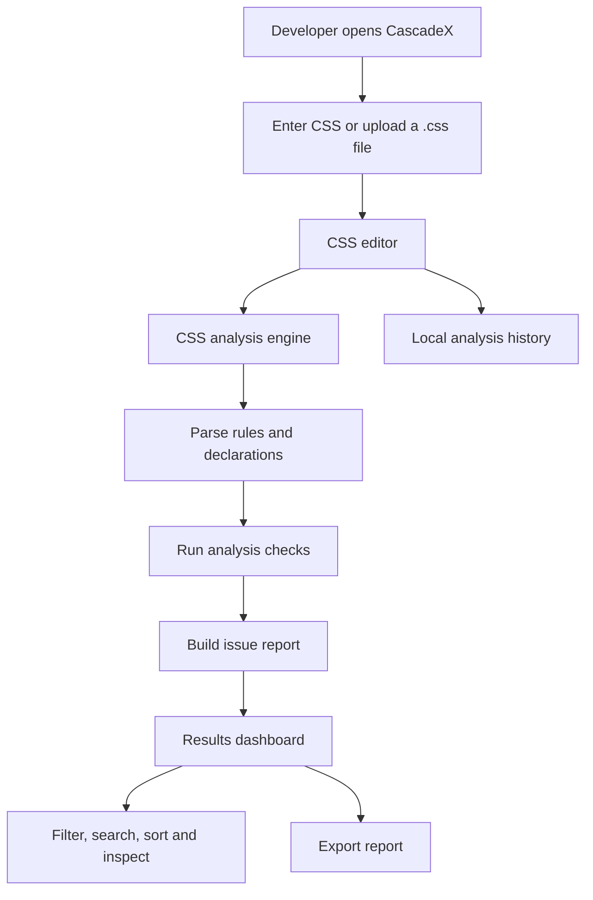
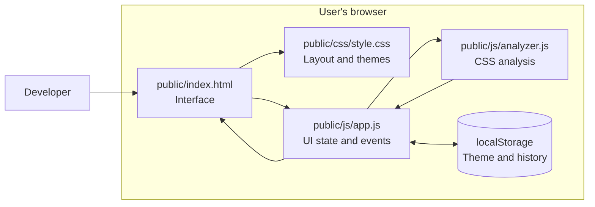
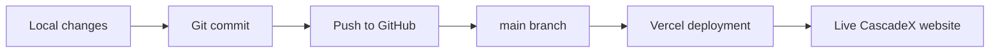

# CascadeX

### Understand your CSS. Find conflicts. Make better styling decisions.

[](https://cascadex-tawny.vercel.app/)
[](https://vercel.com/)
[](https://developer.mozilla.org/en-US/docs/Web/JavaScript)

**CascadeX** is a lightweight, browser-based CSS analysis workspace. It helps developers inspect stylesheets, understand potential cascade conflicts, review selector specificity, and identify common CSS maintenance problems through a focused editor and readable analysis dashboard.

> **Live application:** [https://cascadex-tawny.vercel.app/](https://cascadex-tawny.vercel.app/)

---

## Contents

- [Why CascadeX?](#why-cascadex)
- [Features](#features)
- [Screenshots](#screenshots)
- [How it works](#how-it-works)
- [Architecture](#architecture)
- [Technology stack](#technology-stack)
- [Project structure](#project-structure)
- [Run locally](#run-locally)
- [How to use](#how-to-use)
- [Analysis coverage](#analysis-coverage)
- [Limitations](#limitations)
- [Deployment](#deployment)
- [Roadmap](#roadmap)
- [Contributing](#contributing)
- [License](#license)

---

## Why CascadeX?

CSS can become difficult to maintain as projects grow. Repeated selectors, conflicting declarations, high-specificity selectors, and excessive `!important` usage can make styling unpredictable and difficult to debug.

CascadeX brings several useful checks into one workspace:

- Write or paste CSS into an editor.
- Read CSS with syntax highlighting and line numbers.
- Run static analysis on the stylesheet.
- Review issues grouped by severity.
- Search, filter, sort, and expand analysis results.
- Keep a local history of previous analyses.

CascadeX is designed as a learning-friendly developer utility: it explains potential problems instead of silently changing the user's stylesheet.

## Features

### CSS editor

- CSS text input with syntax highlighting.
- Line-number gutter.
- Fixed-height editor with vertical and horizontal scrolling.
- CSS file upload.
- Character count.
- Clear editor action.

### Analysis engine

The analyzer checks for common stylesheet issues, including:

- Repeated selectors and conflicting declarations.
- Repeated declarations of the same property.
- Potential conflicts between selectors.
- Selector specificity calculations.
- `!important` overuse.
- Undefined CSS custom properties.
- Declared but unused CSS custom properties.
- Empty CSS rules.
- Basic syntax problems.
- Fragile selector patterns, such as deeply nested selectors and multiple ID selectors.

### Results workspace

- Error, warning, and information summary cards.
- Clickable severity filters.
- Search by issue title, selector, or explanation.
- Sorting options.
- Expandable issue details.
- Exportable analysis report.

### Personal workspace

- Light and dark themes.
- Theme preference stored in browser local storage.
- Recent analysis history stored locally in the browser.

For the detailed feature inventory, see [`docs/FEATURES.md`](docs/FEATURES.md).

---

## Screenshots

Add current screenshots of the deployed application in this section when available.

```text
docs/
└── screenshots/
    ├── dashboard.png
    ├── editor.png
    └── analysis-results.png
```

Example Markdown once screenshots have been added:

```md

```

---

## How it works

At a high level, the user provides CSS, the browser-side analyzer inspects it, and the results workspace presents detected issues.



The analyzer is static and heuristic-based. It inspects the CSS source; it does not currently render a website or inspect the page's live DOM.

## Architecture

CascadeX currently uses a simple client-side architecture. The interface is built with HTML and CSS, while JavaScript modules handle editor interactions and stylesheet analysis.



### Main responsibilities

| Component | Responsibility |
|---|---|
| `public/index.html` | Application structure and interface elements |
| `public/css/style.css` | Layout, responsive styling, editor presentation, themes, and syntax-token styles |
| `public/js/app.js` | DOM interactions, editor highlighting, line numbers, file input, analysis display, filters, history, and report export |
| `public/js/analyzer.js` | CSS parsing helpers and static analysis checks |
| Browser `localStorage` | Persists theme choice and local analysis history |

More detail is available in [`docs/ARCHITECTURE.md`](docs/ARCHITECTURE.md).

## Technology stack

| Technology | Usage |
|---|---|
| HTML5 | Application structure |
| CSS3 | Styling, responsive layout, themes, and editor presentation |
| Vanilla JavaScript (ES modules) | UI behavior and analysis logic |
| Browser DOM APIs | Editor interaction, file reading, and result rendering |
| Browser `localStorage` | Theme preference and analysis history |
| Vercel | Static hosting and deployment |
| Google Fonts | DM Sans, DM Mono, and Manrope typography |

CascadeX does not require a frontend framework or a server-side API for its current browser-based workflow.

## Project structure

```text
CascadeX/
├── README.md
├── docs/
│   ├── ARCHITECTURE.md
│   ├── FEATURES.md
│   ├── GOALS.md
│   ├── ROADMAP.md
│   └── TECH-STACK.md
└── public/
    ├── index.html
    ├── css/
    │   └── style.css
    └── js/
        ├── app.js
        └── analyzer.js
```

## Run locally

Because the application uses JavaScript ES modules, open it through a local web server rather than relying on a direct `file://` URL.

### Option 1: VS Code Live Server

1. Clone the repository.
2. Open the project folder in VS Code.
3. Start Live Server from `public/index.html`.
4. Open the local URL shown by the extension.

### Option 2: Use a local static server

If Node.js is installed, run:

```bash
npx serve public
```

Open the local address printed in the terminal.

> If your local project uses a different Vercel root directory or local server setup, use that project's configured directory.

## How to use

1. Open the [CascadeX live application](https://cascadex-tawny.vercel.app/).
2. Navigate to the CSS Analyzer section.
3. Paste CSS into the editor or upload a `.css` file.
4. Select **Analyze CSS**.
5. Review the issue summary.
6. Use severity cards to filter the results.
7. Search or sort issues to find a specific selector or warning.
8. Expand an issue to read its explanation.
9. Export the report if needed.

## Analysis coverage

CascadeX currently performs source-level checks. Examples of the types of findings it can report:

| Check | What it looks for |
|---|---|
| Repeated selectors | A selector appearing in multiple CSS rules |
| Conflicting declarations | Different values assigned to the same property |
| Repeated properties | A property declared more than once inside a rule |
| Cascade conflicts | Different selectors declaring different values for a shared property |
| Specificity | Approximate ID, class/attribute/pseudo-class, and element specificity |
| Custom properties | Undefined uses and declared variables not referenced with `var()` |
| `!important` | Rules containing multiple important declarations |
| Empty rules | Rules without declarations |
| Syntax checks | Basic structural and declaration problems |
| Fragile selectors | Deep selector chains and selectors with multiple IDs |

## Limitations

CascadeX is a lightweight static analyzer, not a replacement for a browser's CSS cascade engine or a standards-complete CSS parser.

- Cascade-conflict findings are **potential conflicts**. The analyzer cannot prove that two selectors match the same DOM element.
- Specificity and selector compatibility are approximations for supported selector syntax.
- Static source analysis cannot determine the final computed style of a live page.
- Inline styles, browser extensions, runtime-generated styles, animations, transitions, cascade origins, and all cascade-layer interactions are not fully evaluated.
- Custom-property usage is checked from the CSS source available to the analyzer; variables used only in external stylesheets or runtime code may not be visible.
- Complex or newer CSS syntax may not be fully interpreted.
- The current workflow analyzes CSS input; it does not yet upload and map an entire website project.

Always verify important findings in the browser's developer tools and against the target page.

## Deployment

CascadeX is deployed on Vercel:

**Production URL:** [https://cascadex-tawny.vercel.app/](https://cascadex-tawny.vercel.app/)

The application is currently a static frontend. The deployed Vercel project should serve the `public` directory as the site root.

Typical deployment flow:



Deployment configuration is managed in the Vercel project. Check its configured root directory and build settings before changing them.

## Roadmap

The next development areas are:

- Improve editor diagnostics and error navigation.
- Expand CSS parser coverage and reduce false positives.
- Support analysis of complete website projects.
- Map HTML files to their stylesheets.
- Offer reviewable CSS fix suggestions.
- Compare analysis reports across runs.

See [`docs/ROADMAP.md`](docs/ROADMAP.md) for the current project plan.

## Contributing

Contributions and suggestions are welcome.

1. Fork the repository.
2. Create a feature branch.
3. Make a focused change.
4. Test the application in a browser.
5. Commit with a descriptive message.
6. Open a pull request with a summary and testing notes.

See [`docs/CONTRIBUTING.md`](docs/CONTRIBUTING.md) for contribution guidelines.

## License

No license has been specified yet. Until a license is added to the repository, all rights remain with the copyright holder and reuse should not be assumed to be permitted.
