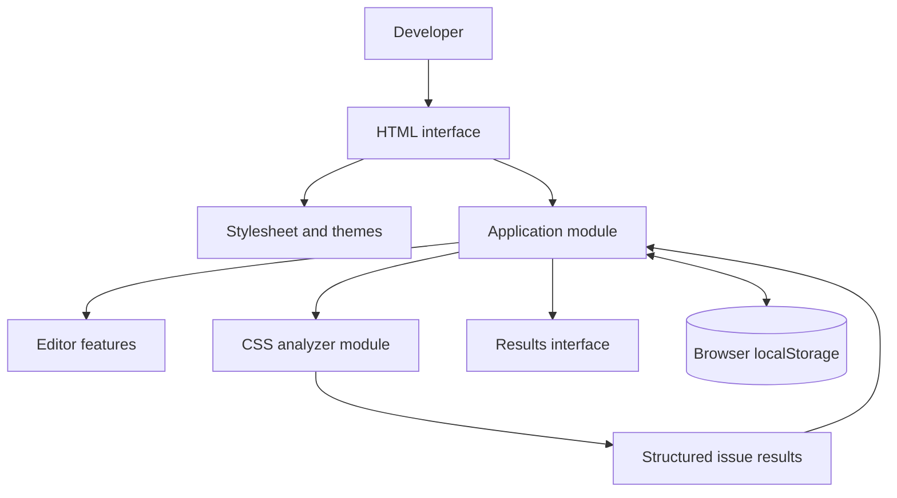
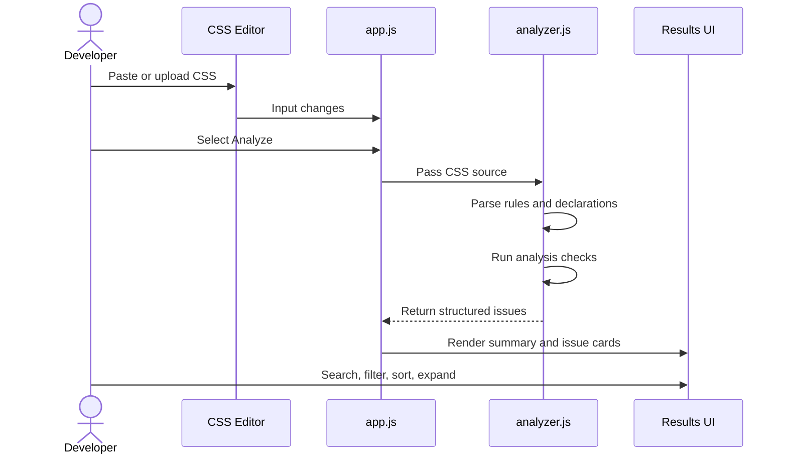

# CascadeX — Architecture

## Overview

CascadeX is currently a client-side web application. The browser hosts the interface, editor behavior, CSS analysis, and local preferences. The current workflow does not require a backend API.

## Modules

### `public/index.html`

Defines the application structure and the DOM elements used by the JavaScript application.

### `public/css/style.css`

Contains the visual system, responsive layout, theme styles, editor layout, syntax-token presentation, and results components.

### `public/js/app.js`

Coordinates browser interactions:

- Reads editor input.
- Updates character count and line numbers.
- Produces syntax-highlighted editor presentation.
- Handles CSS file selection.
- Calls the analyzer.
- Renders and filters findings.
- Manages theme preference and local history.
- Exports the analysis report.

### `public/js/analyzer.js`

Contains stylesheet parsing helpers and static analysis functions. It returns structured findings for the application to display.

## Analysis flow

## State and persistence

The application uses in-memory JavaScript state while the page is open. Browser `localStorage` is used for the theme preference and recent analysis history.

This is browser-local persistence. It is not cloud synchronization and is not shared across devices.

## Hosting

The live application is hosted on Vercel:

- Production URL: https://cascadex-tawny.vercel.app/
- Repository: https://github.com/Manoj-Inturi/CascadeX

The current app is static. Vercel serves the frontend files; no backend service is required for the documented analysis flow.

## Design constraints

- Keep the current implementation lightweight.
- Prefer browser-native APIs.
- Keep analysis separate from UI rendering.
- Return structured findings from the analyzer.
- Do not describe heuristic results as guaranteed browser cascade outcomes.
